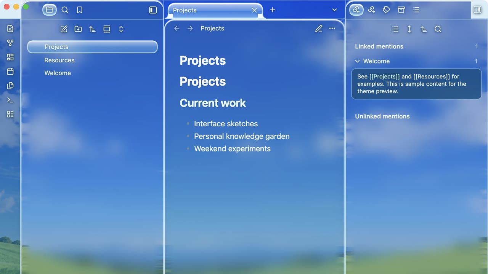

# Frutiger

An original Obsidian theme inspired by Frutiger Aero: clear blue glass, a spring-green landscape, bright controls, and readable note panes. The wallpaper is bundled locally, so the theme makes no network requests.

## Install

After the community release, choose **Frutiger** under Settings → Appearance → Themes. For local testing, copy `theme.css` and `manifest.json` into `<vault>/.obsidian/themes/Frutiger/`, then select it in Appearance.

The optional **Frutiger Liquid Glass** companion plugin adds a WebGL2 glass effect on desktop. The theme works by itself with CSS glass and a static wallpaper.

## Development

`theme.template.css` is the authored CSS. `npm run build` embeds `aero-landscape.jpg` into `theme.css` as a data URI. No package installation or downloaded assets are required for the build. The repository includes only original Frutiger styling and the locally generated landscape image.

## Release checklist

- [x] Test reading and the companion plugin in a clean vault on macOS Obsidian 1.14.5.
- [x] Capture sample-only screenshots.
- [ ] Check editing, light and dark modes, and Settings before community submission.
- [x] Publish this source in a public GitHub repository.
- [x] Create release `0.1.0` with `manifest.json` and `theme.css` attached separately.
- [ ] Submit the repository through [Obsidian Community](https://community.obsidian.md) and address review feedback.
