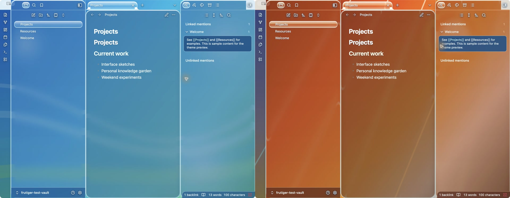

# Frutiger

An original Obsidian theme inspired by Frutiger Aero: clear blue glass, a spring-green landscape, bright controls, and readable note panes. The wallpaper is bundled locally, so the theme makes no network requests.

[Install Frutiger](https://community.obsidian.md/themes/frutiger) · [Add Frutiger Liquid Glass](https://community.obsidian.md/plugins/frutiger-liquid-glass)

## Two visual styles

**Frutiger Aero** uses cool blue and aqua glass over organic landscapes. **Frutiger DORFic** uses copper, orange, cream, and geometric light for a warmer industrial-futurist workspace. Both styles include dedicated contrast palettes for dark glass and light navigation surfaces.

## Install

Choose **Frutiger** under Settings → Appearance → Themes. For local testing, copy `theme.css` and `manifest.json` into `<vault>/.obsidian/themes/Frutiger/`, then select it in Appearance.

The optional **Frutiger Liquid Glass** companion plugin adds a WebGL2 glass effect on desktop. The theme works by itself with CSS glass and a static or procedural wallpaper. The plugin is a separate Community download and does not install with the theme.

## Customize

Install the **Style Settings** community plugin to reveal Frutiger's visual controls under Settings → Style Settings. Frutiger currently includes:

- Frutiger Aero and orange industrial-futurist **DORFic** styles.
- Aero Landscape, Aqua Current, Glass Bubbles, and DORFic Daylight wallpapers.
- Clear, Balanced, and Solid glass-density presets.
- Controls for blur, saturation, panel radius, note/sidebar tint, accent color, and icon contrast.
- A dedicated mobile layout with more opaque single-pane glass, larger touch targets, and separate Aero/DORFic readability palettes.

The three additional wallpapers are procedural CSS, so they add no downloads or network requests. Frutiger Liquid Glass recognizes the same Style Settings classes and updates its WebGL backdrop automatically.

## Mobile

The theme itself supports Obsidian mobile without the companion plugin. Mobile notes, drawers, navigation controls, tasks, tags, callouts, and form fields use a purpose-built single-pane treatment rather than compressed desktop split panes. Reduced-transparency mode replaces blur with solid readable surfaces.

The current mobile pass has been checked with Obsidian's `is-mobile` layout class at a narrow viewport. Confirmation on physical iOS and Android hardware is still welcome.

## Development

`theme.template.css` is the authored CSS. `npm run build` embeds `aero-landscape.jpg` into `theme.css` as a data URI. No package installation or downloaded assets are required for the build. The repository includes only original Frutiger styling and the locally generated landscape image.
